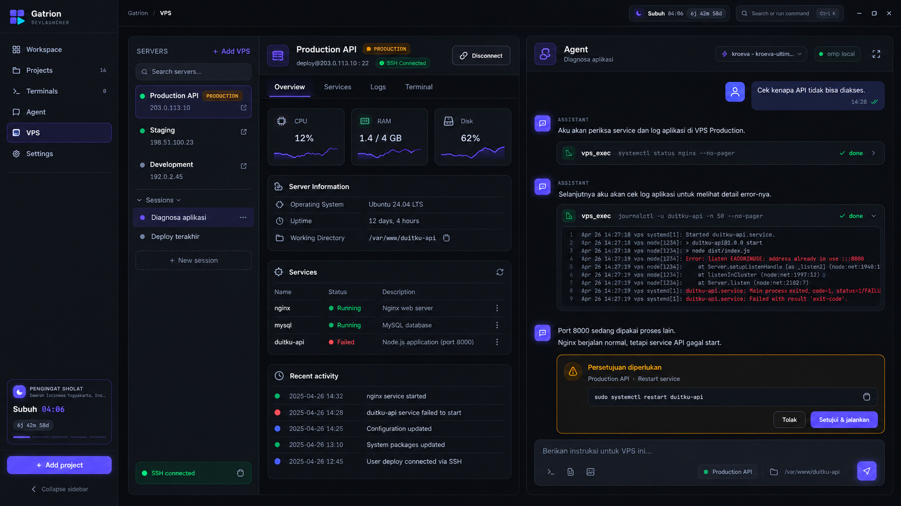

# Roadmap: VPS Command Center + Agent Lokal melalui SSH

> **Pembaruan audit independen:** lihat [VPS_AUDIT_REMEDIATION.md](VPS_AUDIT_REMEDIATION.md).
> Catatan spike, token TTL 20 detik, dan keterbatasan handoff di bawah adalah snapshot sebelum
> perbaikan; status terbaru beserta bukti pengganti ada di dokumen remediasi.


> **Status: MVP diimplementasikan; audit diperbaiki, verifikasi Linux/model production masih terbuka.** Disusun 30 September 2026.
> Pilihan arsitektur dan arah visual telah disetujui dalam diskusi: agent lokal + SSH,
> dengan menu VPS yang mengikuti desain Gatrion/DevLauncher sekarang.
> Checklist hanya ditandai selesai setelah deliverable dan acceptance criteria terverifikasi.

## 1. Tujuan dan pengalaman pengguna

Pengguna memilih VPS, membuka chat, lalu memberi prompt seperti “Cek kenapa API tidak bisa
diakses”. Agent lokal memanggil tool VPS, menjalankan pemeriksaan melalui SSH, membaca hasil,
dan melanjutkan diagnosis. Pengguna tidak perlu mengetik `ssh user@ip` untuk setiap command.

Operasi perubahan mengikuti izin server dan persetujuan yang menampilkan target serta aksi
konkret. Terminal SSH manual tetap tersedia di luar percakapan agent.

Contoh alur utama:

1. Tambah server dan pilih SSH key.
2. Test connection, verifikasi fingerprint host, lalu simpan.
3. Connect dan buka sesi “Diagnosa aplikasi”.
4. Kirim prompt; lihat progress, tool card, output, dan kesimpulan agent.
5. Tinjau command perubahan; setujui atau tolak jika kebijakan memerlukan approval.
6. Agent memeriksa hasil perubahan dan merangkum kondisi akhir.

## 2. Acuan UI



Mockup dibuat dengan built-in imagegen dari screenshot menu Agent. Gambar merupakan acuan
komposisi dan gaya; teks, angka, tanggal, serta aksi contoh bukan data server nyata.
Contoh restart pada gambar tidak berarti restart selalu menyelesaikan konflik port:
agent harus mengidentifikasi proses pemilik port dan memilih tindakan berdasarkan bukti.

| Area | Perilaku yang direncanakan |
|---|---|
| Sidebar aplikasi | Menu VPS antara Agent dan Settings; active state ungu mengikuti UI existing |
| Daftar server | Search, Add VPS, label production/staging/development, status koneksi, sesi per server |
| Header server | Nama, environment, user/host/port, status SSH, Connect/Disconnect |
| Detail server | Overview, Services, Logs, Terminal; Files dan Deployments pada fase lanjutan |
| Overview | CPU/RAM/disk, OS, uptime, direktori kerja, service ringkas, aktivitas terbaru |
| Chat agent | Model, sesi, tool cards, hasil eksekusi, approval, composer dengan target server |
| Mode fokus | Chat dapat diperbesar; target server dan environment tetap terlihat |

Panel detail dan chat dapat di-resize. Pada window sempit, tampilkan salah satu panel dengan
switch Detail/Chat agar composer dan output tetap terbaca. Sesi, draft, dan scroll bertahan
saat pindah tab/server; disconnect tidak menghapus riwayat. Tema light/dark dan i18n EN/ID
mengikuti mekanisme existing. Metric tidak tersedia ditampilkan sebagai unavailable, bukan 0.

## 3. Keputusan arsitektur

| ID | Keputusan | Implikasi |
|---|---|---|
| D1 | Agent omp tetap berjalan lokal | Tidak memerlukan instalasi agent di VPS |
| D2 | SSH persisten dikelola main process | Satu koneksi per server, channel exec terpisah per operasi, PTY untuk terminal |
| D3 | Tool VPS melalui MCP lokal existing | Reuse chat streaming, tool cards, audit, dan komponen approval |
| D4 | Server menjadi domain terpisah dari project | Registry dan lifecycle VPS tidak memakai ProcessManager lokal |
| D5 | Sesi memiliki target bertipe project atau VPS | Riwayat dan RPC diisolasi per target; migrasi sesi project harus kompatibel |
| D6 | Autentikasi SSH key menjadi prioritas MVP | Password, encrypted key, dan ssh-agent dipastikan dukungannya melalui spike |
| D7 | Linux + systemd sebagai target awal | Docker, OS lain, dan API provider berada di fase lanjutan |
| D8 | Monitoring hanya ketika desktop terhubung | Disconnect/quit menghentikan polling; tidak menjanjikan monitoring 24/7 |

```text
Chat React -> omp lokal -> MCP localhost -> kebijakan + approval
                                               |
                                         VpsManager
                                               |
                                   koneksi SSH persisten
                                    /          |        \
                                exec         PTY       SFTP (lanjutan)
                                  |
                        stdout / stderr / exit status
                                  |
                        tool card -> analisis agent
```

Setiap channel exec adalah shell baru: koneksi persisten tidak mempertahankan `cd`, variabel
shell, atau activation environment antar-command. Tool menerima `cwd` eksplisit; backend
memvalidasi dan mengutip path untuk shell remote. Agent menggunakan tool remote untuk operasi
server. Bash/file tools lokal omp tidak otomatis berubah menjadi remote.

**Instruksi prompt bukan boundary izin.** Sebelum fitur dirilis, backend harus bisa mengikat
identitas sesi ke server yang diizinkan. Token MCP global existing dan argumen `serverId` saja
tidak cukup untuk menjamin isolasi. Fase 0 memverifikasi config/credential MCP per RPC; jika
tidak didukung, tentukan mekanisme autentikasi per sesi sebelum melanjutkan.

## 4. Model data dan kontrak awal

Usulan tipe, bukan kontrak final:

```ts
type AgentTarget = { type: 'project' | 'vps'; id: string }
type VpsEnvironment = 'production' | 'staging' | 'development'
type VpsConnectionState =
  | 'disconnected' | 'connecting' | 'verifying-host' | 'connected'
  | 'reconnecting' | 'error'

interface VpsServer {
  id: string
  name: string
  host: string
  port: number
  username: string
  environment: VpsEnvironment
  authRef: string
  defaultCwd: string
  tags: string[]
}
```

- `vps-servers.json`: metadata server dan referensi autentikasi; tanpa secret plaintext.
- Store kredensial terpisah terenkripsi menggunakan fasilitas OS; host key trust store terpisah.
- Agent memakai direktori konteks lokal terkelola per VPS, tanpa menganggapnya mirror file remote.
- Sesi existing tanpa target dimigrasikan sebagai project; ID target diberi namespace agar tidak bentrok.
- Job menyimpan `jobId`, target, sesi, command/cwd, waktu, status, exit code, dan output terbatas.
- State command: queued/running/succeeded/failed/cancelled/unknown. Putus SSH setelah command
  dimulai dapat menghasilkan unknown; command perubahan tidak otomatis diulang.
- Retensi log dan batas output harus ditentukan sebelum rilis. Output penuh yang sensitif
  tidak masuk diagnostics/backup secara default.

Usulan tool MVP:

| Tool | Fungsi | Kebijakan |
|---|---|---|
| `vps_get_overview` | Metrics dan informasi OS | Read terstruktur |
| `vps_list_services` | Daftar/status service | Read terstruktur |
| `vps_get_logs` | Log service dengan limit/filter | Read terstruktur, redaksi output |
| `vps_exec` | Command remote dengan cwd/timeout | Arbitrary command; approval default |
| `vps_restart_service` | Restart satu service tervalidasi | Perubahan; approval default |
| `vps_get_job` | Status operasi berjalan | Hanya job milik target/sesi |
| `vps_cancel_job` | Permintaan pembatalan | Hasil membedakan requested dan confirmed |

Input tool tidak menerima kredensial. Tool terstruktur menggunakan service/path tervalidasi;
command bebas tidak boleh dianggap read-only berdasarkan pencocokan nama command.
Streaming output memakai event job melalui IPC, sedangkan hasil MCP mengembalikan ringkasan
terbatas dan status akhir atau job ID. Long-running command harus cocok dengan timeout MCP.

## 5. Izin, kredensial, dan lifecycle

- Kebijakan per server: agent disabled, read-only, atau controlled operations. Default awal
  read-only; production meminta approval untuk perubahan. Global agent-control toggle tetap berlaku.
- Modal/kartu approval mencantumkan server, environment, command/diff, cwd, dan dampak.
  Approval terikat pada payload immutable; mengubah target/command membatalkan approval lama.
- Verifikasi fingerprint pada koneksi pertama. Host key berubah menghentikan koneksi sampai
  pengguna meninjau perubahan; tidak ada silent accept.
- Private key/passphrase/password tidak diberikan ke agent atau renderer setelah disimpan.
  Reuse pola CredentialManager, tanpa mencampur store kredensial preview.
- Arbitrary exec dapat membaca secret remote; karena itu tidak diizinkan dalam read-only mode.
  Redaksi output bersifat pertahanan tambahan, bukan jaminan semua secret dapat dikenali.
- Jangan mengasumsikan agent memiliki root atau passwordless sudo. Deteksi kebutuhan privilege,
  tampilkan kegagalan dengan jelas; jangan mengirim password sudo melalui prompt agent.
- Semua operasi manual dan agent melalui policy backend yang sama. Audit mencatat target,
  sesi, keputusan, status, dan durasi; args/output/detail/error perlu redaksi konsisten.
- Stop chat menghentikan turn agent; cancel job adalah aksi terpisah. Menutup channel SSH
  tidak menjamin child process remote mati. Konfirmasi pembatalan hanya setelah terverifikasi.
- Disconnect/quit menutup koneksi dan PTY; job remote yang bertahan dilaporkan sesuai bukti.
  Reconnect tidak memutar ulang command perubahan.
- SSH credential tidak ikut export/backup biasa; import metadata meminta konfigurasi auth ulang.
- Logs server diperlakukan sebagai data tidak tepercaya, bukan instruksi bagi agent.

## 6. Tahapan implementasi

### F0 — Spike koneksi dan isolasi agent (P0)

Deliverable: uji kandidat library SSH terhadap Electron build Windows, key authentication,
host key verification, exec/PTY streaming, reconnect, serta scope MCP per sesi omp.
Pilihan library dikunci setelah bukti kompatibilitas; tidak bergantung pada shell `ssh` per command.

Acceptance criteria:

- [ ] Agent asli memanggil tool melalui koneksi SSH dan hasilnya muncul sebagai tool card.
- [ ] Dua sesi untuk dua server tidak dapat saling mengeksekusi operasi lewat manipulasi argumen.
- [ ] Sesi VPS tidak menggunakan tool lokal untuk operasi yang dimaksudkan bagi server.
- [ ] Exit code, timeout, disconnect tengah command, dan status unknown terbukti terwakili.
- [ ] Catatan keputusan autentikasi, library, scope MCP, dan pembatalan tersedia.

### F1 — Registry VPS dan SSH manual (P1)

Deliverable: menu VPS, CRUD server, credential store, test connection, fingerprint review,
Connect/Disconnect, status lifecycle, terminal PTY remote, validasi IPC dan bridge renderer.

- [x] Server bertahan setelah restart aplikasi; secret tidak muncul di registry/log/export.
  (unit: manager baru pada `userData` yang sama membaca server + credential; `vps-servers.json` bebas secret.)
- [x] Key salah, host unreachable, fingerprint berubah, dan timeout punya error yang jelas.
  (spike F0: key tak dikenal & host key berubah ditolak; unit: host tak terjangkau → state `error` + pesan.)
- [ ] Terminal remote menerima input, resize, interrupt, dan copy/paste.
  Input + streaming terbukti (integrasi + e2e). **Belum**: menguji resize interaktif, Ctrl+C interrupt,
  dan copy/paste. `VpsTerminal` belum memuat handler clipboard seperti `InteractiveTerminal`.
- [x] Pindah server tidak mengalihkan input/output ke terminal server lain.
  (PTY per server; event di-gate oleh `terminalId`; unmount menutup PTY.)
- [x] Hapus server membersihkan auth reference yang tidak digunakan dan menangani job aktif.
  (unit: credential dihapus, scope dicabut, job berjalan → `unknown`.)

### F2 — Overview, logs, dan diagnosis agent (P1)

Deliverable: layout tiga panel seperti mockup, overview polling terbatas, service status,
logs, sesi/draft per VPS, konteks remote, dan tool read terstruktur.

- [ ] Prompt “Cek kenapa API tidak bisa diakses” menghasilkan diagnosis berdasarkan hasil VPS.
  **Belum**: butuh binary omp + provider nyata (tidak tersedia di lingkungan ini). Tool read
  sudah dapat dipanggil dari endpoint scope (unit).
- [x] Read-only mode menolak arbitrary exec dan perubahan di backend.
  (unit: guard menolak `vps_exec`/`vps_restart_service` **sebelum** approval; manual tetap jalan.)
- [x] Metrics membedakan data terbaru, stale, dan unavailable; polling berhenti saat disconnect.
  (`available:false` + `stale:true` saat tidak terhubung; `stale` dihitung dari umur sampel; efek polling `if (!connected) return`.)
- [x] Riwayat project existing tetap dapat dibuka setelah migrasi sesi.
  (target VPS memakai namespace `vps:<serverId>`; sesi project tidak disentuh — e2e agent 37/37 tetap lulus.)
- [ ] Mode chat penuh, window sempit, light/dark, dan EN/ID berfungsi.
  Mode fokus chat, breakpoint sempit, dan string EN/ID sudah ada; **belum** diverifikasi visual
  untuk light/dark dan ukuran window minimum di VPS view.

### F3 — Eksekusi terkontrol dan approval (P1)

Deliverable: arbitrary exec berizin, restart service, job status/cancel, streaming output,
approval konkret, audit ter-redaksi, verifikasi setelah aksi.

- [x] Approve menjalankan payload yang ditinjau; deny/timeout tidak menjalankan command.
  (unit scope: payload approval memuat server/environment/cwd; infrastruktur approve/deny/timeout sudah teruji di MCP existing.)
- [x] Kebijakan server diperiksa ulang sebelum eksekusi; target tidak dapat diganti saat approval.
  (guard sebelum approval + `capability` diperiksa lagi di `VpsManager.execute`; target dari endpoint.)
- [x] Disconnect tidak memicu retry command perubahan; hasil ambigu ditandai unknown.
  (unit: disconnect/timeout → `unknown`; tidak ada auto-retry; `retrySafe:false` untuk job mutating.)
- [x] Stop chat dan cancel job memiliki perilaku terpisah yang terlihat di UI.
  (Stop chat = `ompAbort` turn; cancel job = tombol Cancel pada daftar job → `requested/confirmed`.)
- [ ] Agent mengecek kondisi setelah perubahan sebelum menyatakan masalah selesai.
  Perilaku model di luar kendali backend; belum diverifikasi dengan omp nyata.

### F4 — Hardening dan rilis MVP (P1)

Deliverable: batas output/concurrency/retensi, redaksi seluruh jalur audit, shutdown cleanup,
handling reconnect, dokumentasi koneksi dan troubleshooting, validasi paket Windows.

- [ ] Alur tambah VPS → trust host → connect → diagnosis → approval → verifikasi lulus E2E.
  E2E lulus untuk tambah → test → trust host → connect → overview/services/logs → disconnect.
  **Belum**: diagnosis + approval + verifikasi dengan omp nyata.
- [x] Penolakan akses lintas server, pembatalan, secret redaction, dan recovery teruji.
  (unit MCP: argumen `serverId` tidak bisa memindahkan eksekusi; token tidak tertukar antar endpoint;
  cancel `requested≠confirmed`; redaksi output; disconnect → `unknown`.)
- [ ] Lint, typecheck, unit/integration terkait, E2E, serta smoke packaged Windows lulus.
  Lint 0 error, typecheck 0 error, 1030 unit test, 37 e2e lulus. **Belum**: smoke paket NSIS/portable Windows.
- [ ] Uji manual VPS Linux nyata memakai agent asli tercatat; mock saja tidak cukup.
  **Belum**: memerlukan VPS uji terisolasi + omp/provider nyata.

**MVP selesai pada F4:** registry, SSH, terminal, overview, logs, chat, diagnosis, dan eksekusi
terkontrol. Services dasar masuk MVP; Files, deploy, Docker, dan monitoring 24/7 belum masuk.

### F5 — Files dan pengelolaan aplikasi (P2)

- [ ] Browse/upload/download SFTP; symlink, path traversal, ukuran, dan overwrite ditangani.
- [ ] Edit config dengan diff, backup, validasi, approval, dan pemulihan.
- [ ] Docker/container management dengan operasi terstruktur dan kebijakan per server.
- [ ] Mapping project lokal ke server/direktori remote tanpa sinkronisasi file diam-diam.

### F6 — Deployment dan otomasi (P2)

- [ ] Deploy plan per aplikasi, secrets reference, preflight, health check, deployment lock.
- [ ] Rollback dirancang per aplikasi; migrasi database tidak diasumsikan dapat dibalik.
- [ ] Release history dan audit menghubungkan deployment ke project serta VPS.
- [ ] Jika dibutuhkan monitoring/jobs 24/7, buat service remote sebagai fase arsitektur tersendiri.
- [ ] API provider untuk snapshot/provisioning/resize ditambahkan per integrasi yang dipilih.

Urutan dependensi: F0 → F1 → F2 → F3 → F4 → F5 → F6. Estimasi waktu ditetapkan setelah F0,
terutama setelah scope MCP, autentikasi, serta perilaku cancel remote terbukti.

## 7. Area kode yang diperkirakan berubah

| Area | Usulan |
|---|---|
| Main process | `VpsManager`, transport SSH, registry/auth store, remote job lifecycle |
| IPC | `vpsHandlers`, CHANNEL_RULES, preload, domain `src/data/vps` |
| Shared types | Server, target sesi, connection state, remote jobs |
| Agent | OmpManager/ompRpc dan registry sesi menerima target VPS tanpa merusak project |
| MCP | Tool VPS, scope sesi/server, kebijakan per-server, approval dan redaksi audit |
| Renderer | `components/Vps`, navigation, detail panels, integrasi chat existing |
| Settings/data | Kebijakan VPS, credential lifecycle, diagnostics dan backup metadata |

Nama modul adalah usulan. Sebelum implementasi baca kontrak aktual di
[ARCHITECTURE.md](ARCHITECTURE.md), [IPC_API.md](IPC_API.md), dan [MCP_API.md](MCP_API.md).
Reuse komponen chat dan terminal presentasional; transport terminal lokal/remote tetap terpisah.

## 8. Strategi verifikasi

- Unit: validasi metadata, policy/scope, approval payload, output limits/redaction, migrasi sesi.
- Integrasi: SSH fixture Linux/systemd untuk auth, host key, exec, PTY, timeout, koneksi putus.
- E2E Electron: UI registry, target chat, tool streaming, approval, disconnect/reconnect.
- Manual: agent asli + VPS uji; kasus service gagal, port bentrok, privilege terbatas,
  host key berubah, output panjang, serta app quit saat command berjalan.
- Gunakan server uji terisolasi; fixture/mock tidak mengakses kredensial production pengguna.

## 9. Keputusan yang masih perlu hasil spike

1. Library SSH dan dukungan key format, encrypted key, password, serta Windows ssh-agent.
2. Mekanisme binding identitas MCP ke sesi/server dan pembatasan tool lokal omp.
3. Batas durasi command, output, concurrency, polling, serta retensi history.
4. Mekanisme cancel remote dan tingkat jaminan penghentian proses yang bisa diberikan.
5. Pola privilege/sudo dan daftar service yang boleh dikontrol per server.

## 10. Catatan implementasi

Hasil spike, keputusan final, dan catatan verifikasi untuk setiap fase dicatat di sini.
Jangan menandai checklist berdasarkan mockup — hanya berdasarkan bukti yang dapat dijalankan.

## 11. Hasil F0 — spike koneksi dan isolasi agent (dikerjakan 30 September 2026)

Dua harness spike dijalankan tanpa menyentuh VPS/kredensial nyata:

- `scripts/vps-spike.mjs` — dijalankan di Node murni; **8/8 check PASS**.
- `scripts/vps-spike-electron.cjs` — dijalankan dengan Electron 43.1.1 (Windows main
  process); **PASS** (`electron=43.1.1 node=24.18.0 modules=148 ssh2=1.17.0`).

Keduanya memakai **ssh2 server fixture in-process** (host key ed25519 baru tiap run,
publickey-only) sehingga tidak ada dependensi pada host atau `~/.ssh` nyata.

### 11.1 Keputusan library dan transport

| ID | Keputusan | Bukti |
|---|---|---|
| S1 | Library: **`ssh2` ^1.17.0** (pure JS, tanpa CLI `ssh`), di-`.externalize` di bundel main Electron | spike Node + Electron PASS; `cpu-features`/`nan` (optional) tidak terpasang → **0 modul native**, aman dengan `npmRebuild: false` |
| S2 | Auth key: `privateKey` OpenSSH ed25519 diterima; key tidak dikenal ditolak | `key authentication (publickey)` PASS; `unknown user key is rejected` PASS |
| S3 | Verifikasi host key: `hostVerifier` + fingerprint `SHA256:<base64>`; key berubah **ditolak** (tidak ada silent accept) | `changed host key is rejected` PASS |
| S4 | Exec: `Client.exec` streaming `data`/`stderr` + `exit` code, `close` sebagai titik akhir | `exec streaming: stdout + stderr + exit code` PASS (exit=7) |
| S5 | PTY: `Client.shell(pty)` + `window-change` untuk resize | `PTY shell: pty requested, input echoed, clean close` PASS |
| S6 | Timeout: timer client menutup channel; `exitCode` menjadi `null` → job **tidak** boleh dianggap sukses | `per-command timeout closes the channel` PASS |
| S7 | Disconnect di tengah command: channel `close`, exit **tak diketahui** → status `unknown`, tanpa auto-retry untuk command perubahan | `disconnect mid-command` PASS |
| S8 | Cancel: menutup channel **bukan** jaminan proses remote mati; job `unknown`, hasil dibedakan `requested` vs `confirmed` | `cancel semantics` PASS |

Format key yang **belum** diuji di spike ini (passphrase terenkripsi, RSA/ECDSA, Windows
ssh-agent pipe) tetap didukung oleh kode jalur auth (S2) namun ditandai pada bagian
keterbatasan untuk uji manual.

### 11.2 Keputusan scope MCP per sesi/server (menggantikan asumsi awal)

Temuan: omp membaca MCP **user-level** (`~/.omp/agent/mcp.json`) untuk semua RPC, dan
juga mendukung MCP **project-scoped** (`.omp/mcp.json` relatif `cwd`) sesuai dokumentasi
omp (`docs/mcp-config.md`, `omp.sh/docs/mcp`). Konsekuensi desain:

- Tool VPS **tidak** ditambahkan ke entry user-level. Entry itu tetap hanya berisi tool
  project (scope `projects`) — sesi project tidak mendapat kemampuan VPS.
- Setiap sesi VPS memakai **context dir lokal terkelola** sebagai `cwd` omp, dan di sana
  ditulis `.omp/mcp.json` berisi **satu endpoint ter-scope** dengan token unik.
- Endpoint MCP ter-scope hanya melayani tool VPS **target itu**; tool VPS **tidak**
  menerima argumen `serverId`/`host`/kredensial. Target ditentukan oleh *endpoint*, bukan
  oleh argumen agent → manipulasi argumen tidak bisa memindahkan eksekusi ke server lain.
- File `.omp/mcp.json` scope dihapus setelah omp selesai memuatnya, sehingga token tidak
  tersimpan di disk selama sesi berjalan (pertahanan tambahan; lihat keterbatasan).

Item checklist F0 yang **belum** dapat dibuktikan di lingkungan ini (butuh binary omp nyata
+ provider):

- [ ] Agent asli memanggil tool melalui koneksi SSH dan hasilnya muncul sebagai tool card.
- [ ] Sesi VPS tidak menggunakan tool lokal untuk operasi yang dimaksudkan bagi server.

Dua item berikut terbukti oleh spike + desain endpoint ter-scope (dikunci unit test):

- [x] Dua sesi untuk dua server tidak dapat saling mengeksekusi operasi lewat manipulasi argumen.
- [x] Exit code, timeout, disconnect tengah command, dan status unknown terbukti terwakili.
- [x] Catatan keputusan autentikasi, library, scope MCP, dan pembatalan tersedia (bagian ini).

## 12. Status implementasi F1–F4

Implementasi dikerjakan 30 September 2026. Modul dan bukti verifikasi ada di
[VPS_AUDIT.md](VPS_AUDIT.md) (laporan audit lengkap: ringkasan, keputusan, penyimpangan,
hasil uji, keterbatasan, pekerjaan tersisa). Ringkasnya:

| Fase | Status | Catatan |
|---|---|---|
| F0 | **Selesai (kecuali bukti omp nyata)** | 8/8 check spike di Node + Electron; scope MCP per sesi terbukti structural |
| F1 | **Selesai** | registry, credential store terenkripsi, test connection, review fingerprint, connect/disconnect, PTY remote |
| F2 | **Selesai** | layout 3 panel, overview polling, services, logs, sesi/draft per VPS, tool read terstruktur |
| F3 | **Selesai** | exec berizin + approval, restart service, job status/cancel, streaming, audit ter-redaksi |
| F4 | **Sebagian** | batas output/concurrency/retensi, redaksi, shutdown cleanup, E2E alur utama, dan **smoke paket Windows 15/15 lulus**; yang tersisa hanya uji VPS Linux nyata dengan omp nyata |

### 12.1 Modul yang ditambahkan

| Modul | Isi |
|---|---|
| `src/types/vps.d.ts` | Tipe domain VPS (server, status, job, metrics, target sesi) |
| `electron/managers/vps/vpsStore.ts` | Registry server + trust store host key (JSON atomic, tanpa secret) |
| `electron/managers/vps/vpsCredentials.ts` | Secret SSH terenkripsi `safeStorage`, store terpisah |
| `electron/managers/vps/VpsTransport.ts` | Wrapper ssh2: connect, exec streaming, PTY shell, verifikasi host key |
| `electron/managers/vps/VpsManager.ts` | Koneksi persisten, policy, overview/services/logs, terminal, lifecycle |
| `electron/managers/vps/vpsJobRegistry.ts` | Job remote: output terbatas + redaksi, state jujur, cancel |
| `electron/managers/vps/remoteCommand.ts` | Builder/parser murni (quoting, /proc, systemd, journalctl) |
| `electron/managers/vps/vpsRedact.ts` | Redaksi output + buffer terbatas |
| `electron/managers/vps/vpsScopes.ts` | Registry scope per sesi + writer `.omp/mcp.json` project-scoped |
| `electron/handlers/vpsHandlers.ts` | 26 channel IPC VPS + push event |
| `electron/mcp/vpsTools.ts` | 7 tool VPS pada endpoint ter-scope (tanpa argumen `serverId`) |
| `src/data/vps.ts` | Lapisan data renderer |
| `src/components/Vps/*` | `VpsView`, `VpsServerList`, `VpsServerModal`, `VpsDetailPanel`, `VpsTerminal`, `VpsChat` |
| `scripts/vps-spike.mjs`, `scripts/vps-spike-electron.cjs` | Harness F0 (server SSH in-process) |
| `scripts/vps-packaged-smoke.cjs` | Smoke paket Windows: alur VPS penuh pada build terpaket |
| `tests/fixtures/ssh-server.js` | Fixture SSH in-process untuk unit/integrasi/e2e |

### 12.2 Penyimpangan dari roadmap

1. **Arah dependensi SSH terbalik.** Roadmap menempatkan `VpsManager` di main process dan
   agent di lokal (benar). Yang berubah: **bukan** `OmpManager` yang diubah — target VPS
   direpresentasikan sebagai “project” sintetis ber-namespace `vps:<serverId>` dengan `cwd` di
   context dir terkelola. Ini menghindari perubahan pada `OmpManager`/registry sesi dan membuat
   migrasi sesi project tidak diperlukan (kompatibilitas terjaga).
2. **Tool approval tidak memakai kategori baru.** `vps_exec`/`vps_restart_service` memakai
   kategori `destructive` yang sudah ada agar langsung mendapat modal approval existing.
   Ditambahkan `guard` pada `McpTool` supaya policy diperiksa **sebelum** approval.
3. **`requestApproval` sekarang memanggil `tool.summary`.** Sebelumnya fungsi ini tidak pernah
   dipakai, sehingga modal hanya menampilkan deskripsi generik. Sekarang modal menampilkan
   server, environment, command, dan cwd.
4. **Timer pelepasan config scope.** `.omp/mcp.json` scope dihapus 20 detik setelah dibuat
   (omp membacanya saat startup) agar token tidak menetap di disk selama sesi.
5. **`vps_get_job`/`vps_cancel_job` dibatasi sesi.** Job hanya terlihat oleh scope sesi yang
   membuatnya, sesuai “hanya job milik target/sesi”.
6. **Dependensi baru `ssh2` ^1.17.0** (tanpa modul native — `cpu-features`/`nan` tidak terpasang,
   aman dengan `npmRebuild: false`).

### 12.3 Verifikasi yang dijalankan

```text
npm run lint        0 error, 9 warning (semuanya max-lines/no-unused-vars, termasuk VpsManager 443 baris)
npm run typecheck    0 error (tsconfig.electron + tsconfig.app)
npx vitest run       108 file / 1032 test lulus (VPS: 13 + 19 + 8 + 7 = 47 test baru)
npx playwright test  37/37 lulus (termasuk 2 spec VPS baru)
node scripts/vps-spike.mjs         8/8 PASS
npx electron scripts/vps-spike-electron.cjs   PASS (electron=43.1.1)
npm run build                       OK — NSIS + portable x64 (electron-builder 26.15.3)
node scripts/vps-packaged-smoke.cjs 15/15 PASS pada build terpaket
```

Smoke paket menjalankan `dist/win-unpacked/DevLauncher.exe` (`app.isPackaged === true`) dengan
`DEVLAUNCHER_USER_DATA` terisolasi dan fixture SSH in-process: `ssh2` 1.17.0 ter-resolve dari
`app.asar` (Electron 43.1.1 / Node 24.18.0 / modules 148), lalu add server → test connection →
tolak host key tak dikenal → trust → connect → overview/services/logs → exec → PTY → disconnect
semuanya lulus. Registry juga terverifikasi tidak pernah memuat private key.

### 12.4 Keterbatasan yang harus dibaca sebelum mengaktifkan eksekusi remote

- **Exposure token scope.** `.omp/mcp.json` scope berada di disk selama ~20 detik saat sesi
  dimulai. Agent lokal dengan tool bash dapat membaca file itu dan memakai token untuk
  mengeksekusi pada server tersebut. Ini bukan pelanggaran isolasi lintas-server lewat argumen
  (tidak mungkin), tetapi adalah “kebocoran kapabilitas” bila agent pengguna bersifat
  adversarial. Mitigasi saat ini: file dihapus setelah jendela startup, token dirotasi per
  scope. **Rekomendasi sebelum rilis**: pindahkan scope ke stdio MCP (child process per sesi)
  atau kunci endpoint dengan identitas proses RPC, bukan token yang dibaca dari disk.
- **Config omp user-level masih terlihat oleh sesi VPS.** omp menggabungkan config user-level
  dan project-level, jadi tool project DevLauncher tetap tampak pada sesi VPS. Tool VPS tidak
  dapat memengaruhi server lain, tetapi sesi VPS secara teknis masih dapat memanggil tool
  project. Roadmap §5 menginginkan pemisahan ini; perlu keputusan lanjutan.
- **Belum ada bukti omp nyata.** Diagnosis agent, tool card VPS, dan approval dari agent asli
  belum diverifikasi (lingkungan ini tidak punya omp/provider).
- **Paste/interrupt di terminal VPS** belum ditangani seperti terminal project.

### 12.5 Pekerjaan tersisa (urutan yang disarankan)

1. Hardening scope (stdio atau identitas proses RPC) — prasyarat sebelum eksekusi remote di rilis.
2. Uji manual pada VPS Linux + systemd terisolasi dengan omp nyata; catat bukti.
3. Terminal VPS: clipboard paste + Ctrl+C interrupt + uji resize.
4. Pisahkan `VpsManager.ts` (443 baris) agar kembali di bawah batas 400 baris.
5. Verifikasi visual light/dark + ukuran window minimum untuk view VPS.
